# 📡 Distributed Position Estimation of an Object with a Sensor Network and Coordinated Drone Intervention

**Project for the course *Distributed Control and Cyber-Physical Systems Design* – MSc in Computer Engineering (A.Y. 2025/26)**

A network of four **ESP8266** nodes, each equipped with an **HC-SR04** ultrasonic sensor, localizes an intruder **without any central node**: every node exchanges only its *position estimate* with two neighbours and, by iterating a consensus algorithm with a correction based on the local measurement, the whole network converges to the same estimate. The resulting position is then used to coordinate the intervention of two drones, only one of which knows the target (leader-based consensus).

The system was first validated in **MATLAB/Simulink** (ideal case → non-idealities → imperfect network → distributed averaging → energy → drones) and then built as a **scaled physical prototype**.

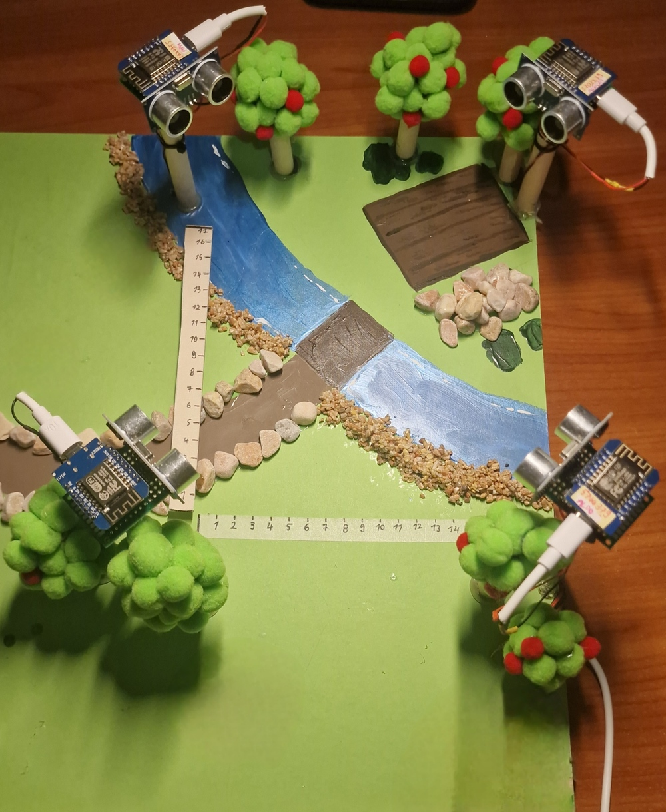

---

## 📑 Table of Contents

- [Goal and basic idea](#-goal-and-basic-idea)
- [The HC-SR04 proximity sensor](#-the-hc-sr04-proximity-sensor)
- [System design](#-system-design)
- [Distributed estimation algorithm](#-distributed-estimation-algorithm)
- [MATLAB/Simulink simulation](#-matlabsimulink-simulation)
- [Physical implementation](#-physical-implementation)
- [Drone intervention](#-drone-intervention)
- [Repository structure](#-repository-structure)
- [Limitations and future work](#-limitations-and-future-work)
- [Documentation](#-documentation)
- [Author](#-author)

---

## 🎯 Goal and basic idea

Determine the position of a detectable source (an **intruder**) **in a distributed way**, relying only on local cooperation between nodes.

The problem splits into two parts:

1. **Local sensing** – each node measures its own distance from the object.
2. **Distributed estimation** – nodes, exchanging data only with their neighbours, converge to a common estimate of the position.

A further **distributed averaging** phase follows (so that everyone decides on exactly the same point), together with the **coordination of two drones** towards the estimated target.

---

## 📏 The HC-SR04 proximity sensor

To obtain a measurement, the node sends a 10 µs high pulse on the `TRIGGER` pin. The sensor emits an ultrasonic wave and raises the `ECHO` pin until the echo returns: the pulse duration is the round-trip time, hence

$$
d\;[\mathrm{cm}] = \frac{\text{duration}\,[\mu s] \cdot 0.034}{2}
$$

where 0.034 cm/µs is the speed of sound and the division by 2 accounts for the round trip.

| Characteristic (datasheet) | Value |
|---|---|
| Power supply | +5 V DC |
| Quiescent / working current | < 2 mA / 15 mA |
| Ranging distance | 2 – 400 cm |
| Resolution | 0.3 cm (verified experimentally) |
| Measuring angle | 30° |
| Trigger pulse width | 10 µs |

The measurement is **accurate and stable**, ideal as input to the algorithm. A feature that is decisive for the rest of the project is the **30° field of view**.

---

## 🧭 System design

### Node placement

Four nodes are placed at the corners of a square area with a side of **17 cm**, at coordinates `(0,0)`, `(0,17)`, `(17,0)` and `(17,17)`, facing inwards so that their fields of view overlap and allow **multilateration**.

Some considerations from the analysis:

- there are **areas not covered** by any sensor, where the intruder is not detected;
- there are **areas covered by only one or two sensors**: the intruder is detected but its position **cannot be determined** (at least three measurements are needed for a reliable multilateration);
- in practice this can be improved with more sensors and/or sensors with a wider field of view.

### Position determination (centralized approach)

Each node's measurement is the radius of a circle centred on the node; the intruder's position is the intersection of the circles:

$$
\begin{cases}
x^2 + y^2 = d_1^2\\
x^2 + (y-17)^2 = d_2^2\\
(x-17)^2 + y^2 = d_3^2\\
(x-17)^2 + (y-17)^2 = d_4^2
\end{cases}
$$

The system is overdetermined and, with a non-point-like object and noisy measurements, the circles do not intersect in a single point (one gets the intersection of **circular annuli**). Solving it also requires all the measurements to be available in one place → a **centralized approach**, which we want to avoid.

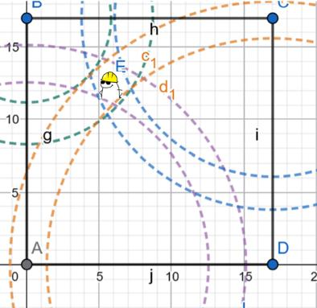

---

## 🧮 Distributed estimation algorithm

The nodes are connected in a ring topology in which **each node talks to only two neighbours**:

```
   (0,17) Pippi ───────── Alessia (17,17)
        │                       │
        │                       │
   (0,0) Fourth node ──── Aldo (17,0)
```

$$
A=\begin{bmatrix}0&1&0&1\\1&0&1&0\\0&1&0&1\\1&0&1&0\end{bmatrix},\qquad
D=\mathrm{diag}(2,2,2,2)
$$

Each node does not exchange the measured distance, but its **position estimate** $(X_i, Y_i)$, and corrects it until convergence.

At each step node *i*:

1. **Averages** its own estimate with those received from its $d_i$ neighbours:

$$
X_{avg}=\frac{X_i(k)+\sum_{j\in N_i}a_{ij}X_j}{1+d_i},\qquad
Y_{avg}=\frac{Y_i(k)+\sum_{j\in N_i}a_{ij}Y_j}{1+d_i}
$$

2. Computes the **vector** from the sensor to the averaged point and its length:

$$
r_x=X_{avg}-X_{sensor},\quad r_y=Y_{avg}-Y_{sensor},\quad r=\sqrt{r_x^2+r_y^2}
$$

3. Computes the **error** with respect to the actually measured distance: $\;error = r - d_{measured}$.
   If positive, the estimated point is too far from the node; if negative, too close.

4. **Corrects** the estimate along the unit vector $u=(r_x/r,\;r_y/r)$:

$$
X_i(k+1)=X_{avg}-\alpha\cdot error\cdot u_x,\qquad
Y_i(k+1)=Y_{avg}-\alpha\cdot error\cdot u_y
$$

where $\alpha$ is the update step.

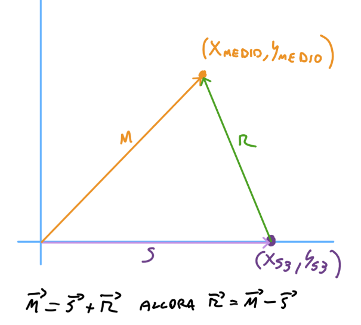

### Pseudocode (for each node)

```text
initialize the common estimate
read the proximity sensor

if distance < threshold:              # the node "sees" the intruder
    send own estimate to neighbours
    (Xavg, Yavg) = average(own estimate, neighbours' estimates)
    r = |(Xavg, Yavg) - sensor_position|
    error = r - measured_distance
    estimate = (Xavg, Yavg) - α · error · unit_vector(r)
else:                                 # the intruder is not in the field of view
    send nothing
    estimate = average(own estimate, estimates received from neighbours)
```

A node that **does not see** the intruder does not transmit, but keeps **averaging** the received estimates: this way it too becomes aware of the position.

### Distributed averaging phase

The nodes' estimates converge "more or less" to the same value. To make everyone decide on **exactly the same point**, after a certain number of iterations the nodes stop estimating and apply a **discrete-time consensus** (distributed averaging) starting from the last computed estimate:

$$
X_i(k+1)=X_i(k)-\varepsilon\sum_{j\in N_i}a_{ij}\,(X_i-X_j),\qquad X_i(0)=x_{st}
$$

(and likewise for $Y$), with $0<\varepsilon<1/d_M$. Since the maximum degree is $d_M=2$, $\varepsilon = 0.5$ is used.

---

## 🧪 MATLAB/Simulink simulation

Before building the physical system, it was simulated in six incremental steps. The models are in [`simulink/`](simulink/).

| File | Content |
|---|---|
| [`s1_stima_ideale.slx`](simulink/s1_stima_ideale.slx) | Ideal case: point-like object, perfect measurements |
| [`s2_stima_non_idealita.slx`](simulink/s2_stima_non_idealita.slx) | Time-based measurement, sensor noise, non-point-like object, one measurement per second |
| [`s3_stima_con_rete.slx`](simulink/s3_stima_con_rete.slx) | Addition of the network model (delays and packet loss) |
| [`s4_media_distribuita.slx`](simulink/s4_media_distribuita.slx) | Distributed averaging phase after the estimation |
| [`s5_livello_energetico.slx`](simulink/s5_livello_energetico.slx) | Node energy model (battery discharge) |
| [`s6_intervento_droni.slx`](simulink/s6_intervento_droni.slx) | Leader-based consensus and PI control of two drones |

### Process model

A MATLAB Function models the physical process: given as input `(x_r, y_r)`, the real position of the object (or `(-1,-1)` if absent), it returns for each node the distance only if the object lies **inside the 30° viewing cone**; otherwise it returns the maximum distance (22 cm, since the diagonal of the square is about 24 cm). The cone is checked by comparing the slope of the node–object line with the slopes bounding the field of view.

### Node model

Each node receives the distance from the process model and the estimates of its two neighbours, and outputs:

- its own estimate to the neighbours, **only if it sees the object** (`-1` otherwise, meaning "I am not communicating");
- the estimate as an output for visualization purposes.

The simulation uses $\alpha=0.5$ and a detection threshold of 20 cm.

### Non-idealities introduced

1. **Non-point-like object** – the equivalent of 0.5 cm is subtracted from the time of flight, to emulate the object's size (each node "thinks" the object is slightly closer).
2. **Measurement noise** – a random number added to the time (in µs) returned by the model.
3. **Sampling** – one measurement per second, as in the physical implementation; the model provides the *time*, which the node converts to cm (like the real HC-SR04).
4. **Imperfect network** – delays and packet loss, using the network model seen in class (a queue with bandwidth and random input rate, which also emulates heavy load or attacks). Four network subsystems, one per node, connect each node's output to its two neighbours.

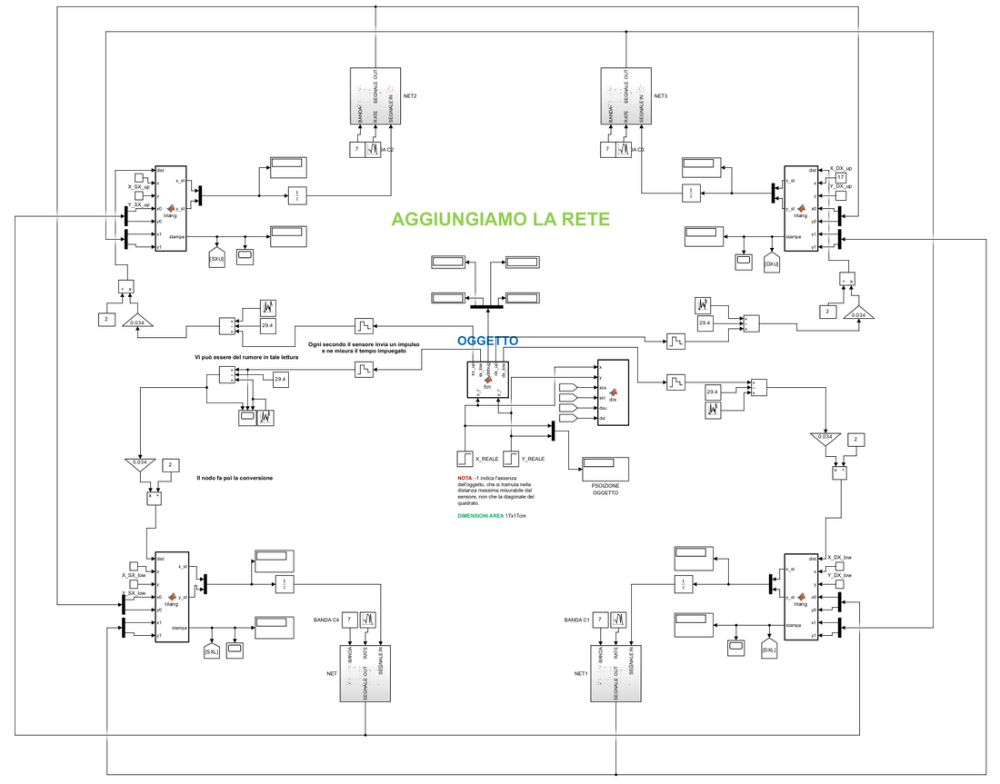

### Results

In the presence of non-idealities the nodes **do not converge exactly** to the real point (an effect of the non-point-like object), but they converge to a region very close to it:

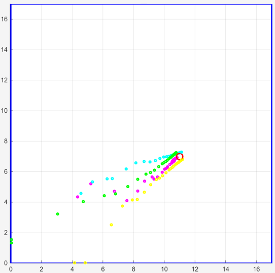

With the network (even with high delays and packet loss, which leave the output signal "flat" in some intervals) the estimate still converges:

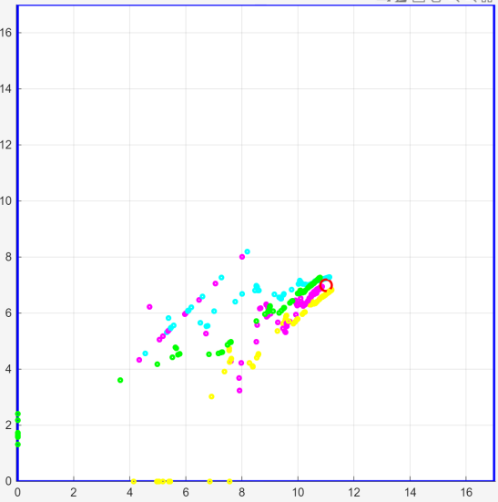

With **distributed averaging** (activated after 40 steps) all nodes settle on the same value, up to a negligible error:

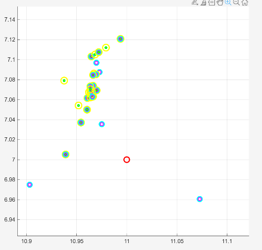

If instead too few nodes see the object (areas covered by one/two sensors), the position **cannot be determined**, as predicted by the geometric analysis.

### Energy level

Battery model of each node:

$$
\dot E = -E_{idle/comp} - E_{TX},\qquad E(0)=100
$$

- idle/computation consumption: **0.5**;
- if the node transmits (output ≠ −1), **1.3** is added;
- the energy is integrated; when it reaches zero the node **shuts down** and stops participating.

A node that always sees the object transmits continuously and discharges sooner; a node that initially sees nothing consumes little until the averaging phase starts, in which everyone transmits.

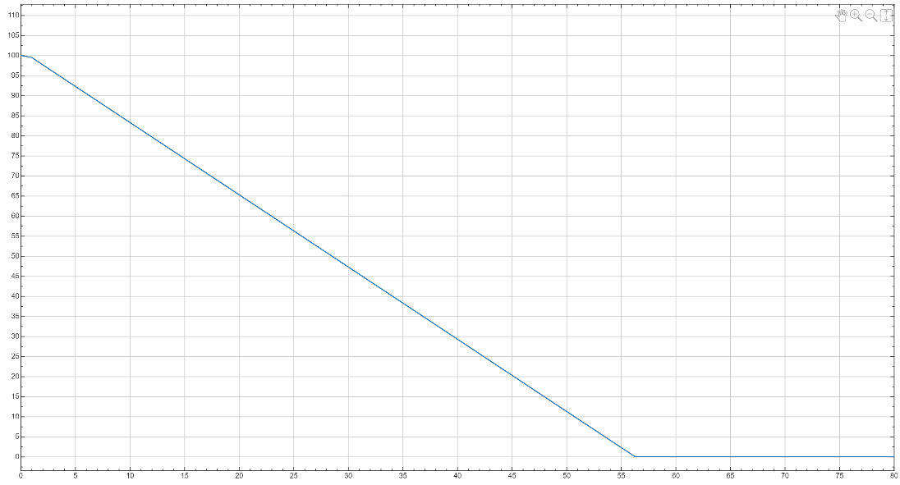

---

## 🔩 Physical implementation

### Hardware

- 4× **ESP8266** (sensing nodes)
- 4× **HC-SR04** ultrasonic sensors
- 1× additional **ESP8266** acting as a **sniffer** (does not take part in the algorithm)
- A scale test bed with four "towers" at the corners of the monitored area

Wiring of each node: `TRIG → D6`, `ECHO → D7`, 5 V and GND for the sensor.

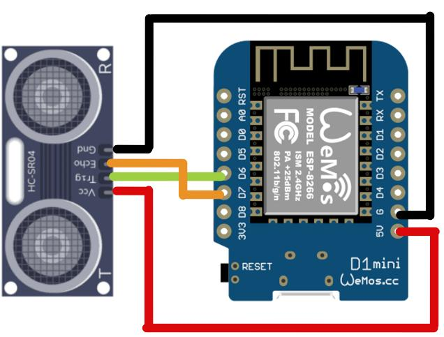

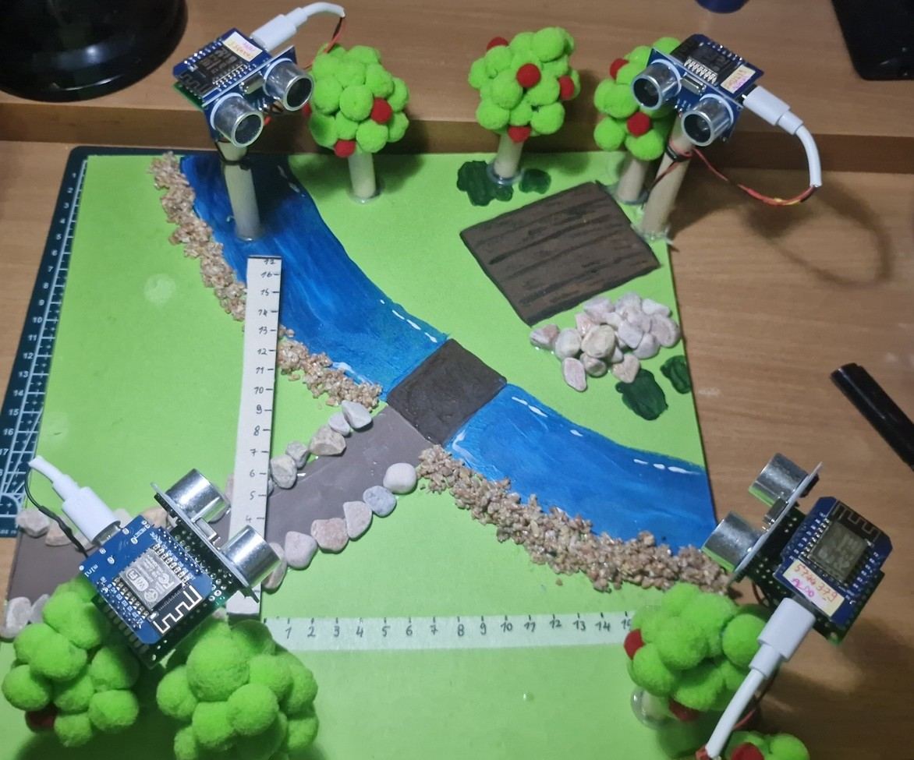

### Mesh communication

Nodes communicate through **[painlessMesh](https://gitlab.com/painlessMesh/painlessMesh)**, which makes it easy to build a mesh network. It is enough to initialize the protocol and register the callbacks:

```cpp
mesh.init(MESH_PREFIX, MESH_PASSWORD, &userScheduler, MESH_PORT, WIFI_AP_STA, 6);
mesh.onReceive(&receivedCallback);
mesh.onNewConnection(&newConnectionCallback);
mesh.onChangedConnections(&changedConnectionCallback);
mesh.onNodeTimeAdjusted(&nodeTimeAdjustedCallback);
```

Messages are strings in the format:

```
type-X-Y        e.g.  "1-8.52-9.10"
```

| `type` | Meaning |
|---|---|
| `1` | Algorithm message: position estimate used for the distributed estimation |
| `2` | Debug message for the **sniffer** (used only for the plot) |

Every node sends in *broadcast*; only messages coming from the two configured neighbours (`vicino1`, `vicino2`) are used in the average.

### Firmware behaviour

A scheduler `Task` runs every second and:

1. takes a measurement (10 µs `TRIG`, `pulseIn(echo)`, `cm = duration / 58`);
2. if `cm ≤ 20` the node "sees" the intruder, **transmits** its estimate and decrements its energy.

When a type-1 message is received (`receivedCallback`), `stimadistribuita()` is executed, implementing the algorithm described above (with $\alpha=0.2$). Right after, the updated estimate is also sent as a type-2 message to the sniffer.

**Simulated energy.** On the physical system too the energy level is *simulated* through an `energia` variable (initially 200), decremented at every transmission; at energy 0 the node shuts down (LED steadily on, measurement task disabled).

### Nodes and topology

| Node | File | Position | Neighbours |
|---|---|---|---|
| Fourth node ("Vuoto") | [`QUARTONODO`](esp8266/QUARTONODO/QUARTONODO.ino) | `(0, 0)` | Pippi, Aldo |
| Pippi | [`PIPPI5624955`](esp8266/PIPPI5624955/PIPPI5624955.ino) | `(0, 17)` | Fourth node, Alessia |
| Alessia | [`ALESSIA5702239`](esp8266/ALESSIA5702239/ALESSIA5702239.ino) | `(17, 17)` | Pippi, Aldo |
| Aldo | [`ALDO5744379`](esp8266/ALDO5744379/ALDO5744379.ino) | `(17, 0)` | Fourth node, Alessia |
| Sniffer ("Laura") | [`LAURA2771019597`](esp8266/LAURA2771019597/LAURA2771019597.ino) | – | receives everything, does not participate |

> 📝 The **clean, commented code** is the one in the `PIPPI5624955` folder; the other nodes differ only in name, position and neighbour IDs.
>
> ⚠️ The numbers in the folder names and the `vicino1`/`vicino2` constants are the **painlessMesh IDs** of my ESP8266 boards (derived from the chip). With different hardware they must be replaced with the IDs of your own nodes, which are printed on the serial port at startup (`ID: ...`).

### Sniffer and real-time plot

The **sniffer** is a node that only listens to type-2 messages and, at every update, prints on the serial port a CSV line with the latest estimates of the four nodes:

```
sxu_x,sxu_y,sxl_x,sxl_y,dxu_x,dxu_y,dxl_x,dxl_y
```

The Python script [`pc/plot_su_pc_di_sniffer.py`](pc/plot_su_pc_di_sniffer.py) reads the serial port and plots in real time the estimates of the four nodes on the 17×17 square, **replicating the MATLAB plot**.

### Tests

Test with the estimate starting point at `(0,0)`:

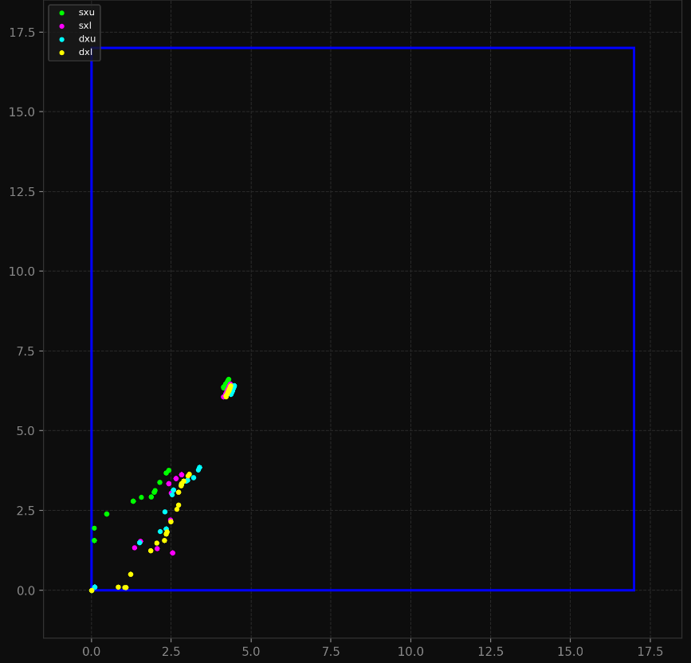

In practice starting from `(0,0)` is not always ideal; some tests were therefore run with a central starting point `(8.5, 8.5)`:

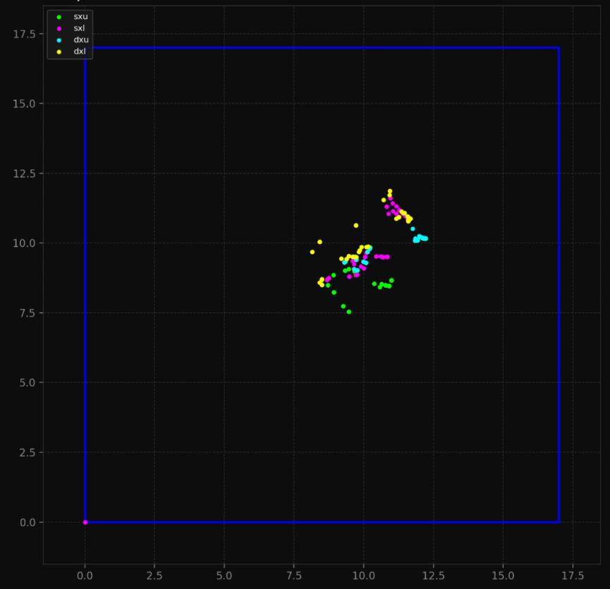

The test videos are in [`media/videos/`](media/videos/).

### Design choice: distributed averaging not implemented on hardware

The firmware **does not activate the second phase (distributed averaging)**, although it is easy to implement and it worked (in the node files the corresponding block is present but commented out). The problem is the **synchronization of the phase change**: in MATLAB the nodes switch to the next phase almost simultaneously, in reality they do not, and some nodes were using data from one phase while others used data from the next, making the result wrong. The solutions considered:

1. an **external signal** making everyone switch phase → discarded because it makes the system more centralized;
2. a **leader node** that, through another distributed algorithm (leader/reference consensus), makes everyone move to the next phase → very similar to what is already used for the drones, not implemented to avoid burdening the project further.

---

## 🚁 Drone intervention

The estimated position is used to coordinate the intervention of **two drones**. Only **drone 1** communicates with the sensor network and knows the estimated position (external reference); **drone 2** only exchanges its own knowledge with drone 1. With a **leader/reference consensus** both converge to the same target position.

Each drone consists of three parts:

1. a **MATLAB Function** implementing the leader/reference consensus;
2. a **PI controller** that drives the drone to the target position;
3. two **second-order processes** modelling the drone along the X and Y axes.

Consensus with reference (drone 1, X axis; same for Y):

```matlab
x = x - 0.5*(x - xj) - 0.5*(x - reference);
```

Drone 2, which does not know the reference:

```matlab
x = x - 0.5*(x - xj);
```

The algorithm starts when the estimation phase is over (in the example, at `t = 80`). The communication between the two drones also goes through the network model, with the same non-idealities.

**Drone dynamics** – second-order transfer function per axis:

$$
G(s)=\frac{\omega_n^2}{s^2+2\zeta\omega_n s+\omega_n^2}=\frac{0.25}{s^2+0.8\,s+0.25}
$$

with $\omega_n=0.5$ (a deliberately slow response, consistent with a drone that gradually reaches the position) and $\zeta=0.8$ (convergence without excessive oscillations).

Drone 2 starts with zero knowledge and, as soon as the consensus starts, its knowledge converges to the target; the PI controller then brings both drones to the estimated position.

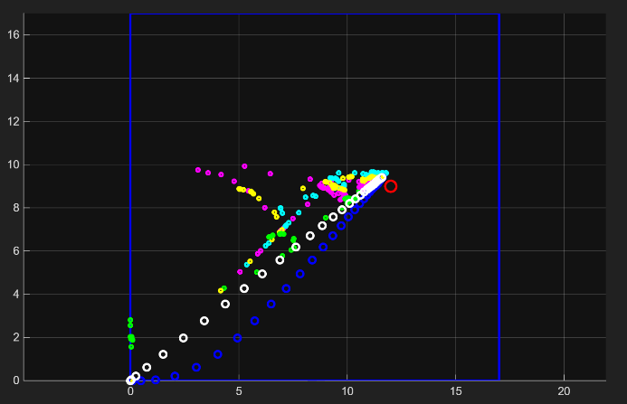

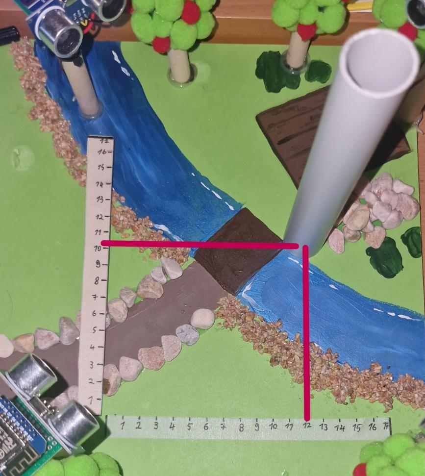

---

## 📁 Repository structure

```
.
├── README.md
├── docs/
│   ├── TesinaMarcoSciaudone.pdf     # full report
│   ├── Traccia.pdf                  # assignment given by the course
│   └── images/                      # images used in the README
├── simulink/
│   ├── s1_stima_ideale.slx
│   ├── s2_stima_non_idealita.slx
│   ├── s3_stima_con_rete.slx
│   ├── s4_media_distribuita.slx
│   ├── s5_livello_energetico.slx
│   └── s6_intervento_droni.slx
├── esp8266/
│   ├── PIPPI5624955/            # reference code (clean and commented)
│   ├── ALESSIA5702239/
│   ├── ALDO5744379/
│   ├── QUARTONODO/
│   └── LAURA2771019597/         # sniffer
├── pc/
│   └── plot_su_pc_di_sniffer.py # real-time plot of the sniffer data
└── media/
    ├── photos/
    └── videos/
```

---

## 🛠️ Limitations and future work

- **Coverage**: with four 30° sensors there are blind spots and areas covered by fewer than three sensors, where the position cannot be determined → more sensors and/or sensors with a wider field of view.
- **Non-point-like object**: each node tends to estimate the object closer than it really is; distributed averaging reduces the spread between nodes but does not remove this bias.
- **Distributed averaging on hardware**: requires a distributed mechanism to synchronize the phase change (e.g. a leader-based consensus).
- **Energy**: on the prototype consumption is simulated in software, not measured.
- **Drones**: the intervention is validated only in simulation.

---

## 📚 Documentation

The full report, with derivations, code and all simulations, is in [`Project.pdf`](Project.pdf). 

**Keywords:** distributed algorithms · position estimate · consensus · ESP8266 · painlessMesh · MATLAB · Simulink

---

## 👤 Author

**Marco** – MSc in Computer Engineering, *Distributed Control and Cyber-Physical Systems Design* (A.Y. 2025/26)
